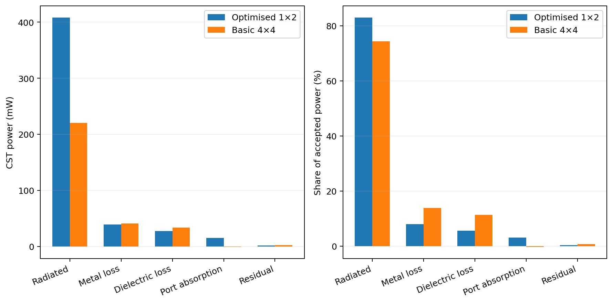

# 150 GHz Power Loss 与匹配分解

| CST 原生积分项 | Optimised 1×2 (mW) | Basic 4×4 (mW) | 1×2 (% Accepted) | 4×4 (% Accepted) |
|---|---:|---:|---:|---:|
| Accepted | 492.233 | 296.613 | 100.000 | 100.000 |
| Radiated | 408.523 | 220.550 | 82.994 | 74.356 |
| Gold | 39.154 | 41.164 | 7.954 | 13.878 |
| Polyimide | 27.414 | 33.698 | 5.569 | 11.361 |
| Port Absorption（CST 带符号项） | 15.388 | −0.939 | 3.126 | −0.317 |
| Closure Residual（扣除以上各项） | 1.754 | 2.140 | 0.356 | 0.721 |

[Power Balance CSV](../02_Simulation_Results/Power_Loss/Power_Balance_150.csv) · [CST 原生导出](../Native_Exports/) · [完整指标表](../03_Comparison/Array_1x2_vs_4x4_Comparison.csv)

4×4 的 Gold 和介质绝对损耗分别增加 2.010 mW 和 6.284 mW。由于匹配不同，按各自 Accepted Power 归一后的差异更能反映已接受功率的去向，分别增加 5.924 和 5.792 个百分点。4×4 从端口至 inset 的路径约 7.948 mm，1×2 约 1.718 mm。T-junction 为 15 对 1，总线长 41.702 对 2.590 mm。导体/介质积分覆盖贴片、馈线和地板等整个模型。更长的布线及更多变换段是可能的损耗机制，当前数据无法单独量化 feed-only 损耗。独立定量需要分区域的 CST 损耗积分或去嵌入的馈电网络对照。

4×4 的带符号 Port Absorption 为 −0.939 mW。它按 CST 原始数值保留在平衡式。Accepted 减 Radiated、Gold、Polyimide 后差额为 1.201 mW（0.405% Accepted）；再减该负号项后残差为 2.140 mW（0.721%）。这项差异反映端口和数值闭合的核查范围，无源模型的物理耗散应为非负。

## 为什么 Total Efficiency 降至 45.52%

- Radiation Efficiency = P_radiated / P_accepted，只衡量已接受的功率中有多少辐射。
- 在统一的 50 Ω 参考下，反射比例 = 10^(S11_dB/10)。4×4 的 −4.114 dB 对应约 38.78% 被反射，余下约 61.22% 被接受。1×2 的 −17.074 dB 对应约 1.96% 被反射。
- 以单端口 50 Ω 功率定义，总效率 = η_rad × (1 − |Γ_50|²)。4×4：74.356% × 61.22% ≈ 45.522%。50 Ω 反射比例和上表 CST 模态参考的绝对功率采用各自的参考面与归一化数据。
- Directivity 表示远场方向分布，Realized Gain 将 Total Efficiency 纳入。4×4 峰值 12.058 dBi 加上 10 log10(0.45522) 后为 8.640 dBi。因此 +2.918 dB 的 Directivity 提升只带来 +0.396 dB 峰值 Realized Gain，固定 +Z 下降 0.101 dB。

