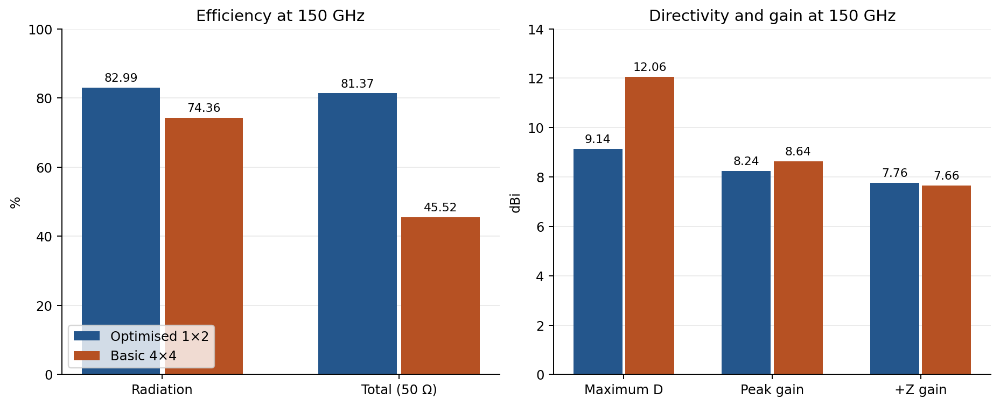
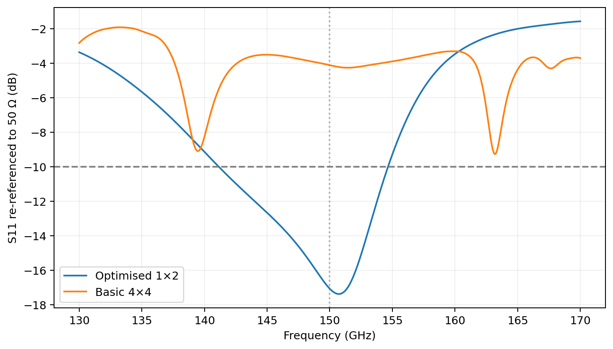

# Comparative study of 1×2 and 4×4 D-band patch arrays

## 1. Objective

Test whether a conventional 16-patch array provides enough usable gain at 150 GHz to justify changes in losses, matched bandwidth, board size, and feed complexity relative to a validated two-element array.

## 2. Design configurations

The optimised 1×2 uses the saved first-round delivery model. The 4×4 uses identical patch orientation with 1.12 mm X pitch and 1.25 mm Y pitch. A single-layer corporate network splits first between rows and then into patch pairs. Side entry provides clearance between the feed and radiating edges, and all sixteen ideal centreline paths are equal. The off-aperture feed is physically asymmetric. Both arrays use the same nominal 75 μm Polyimide (εr = 3.5, tanδ = 0.0027) and 2 μm Gold (σ = 4.561 × 10⁷ S/m).

The retained geometry includes these basic matching settings. match_start = 0.17, match_length = 0.14, match_width = 0.045.

| Screen case | ηrad (%) | S11 at 150 GHz (dB) | Best S11 (dB) | Frequency of best match (GHz) |
|---|---:|---:|---:|---:|
| Initial_4x4 | 72.535 | -2.349 | -10.840 | 139.760 |
| Matched_Input_4x4 | 74.140 | -4.161 | -9.119 | 163.120 |
| Matched_Stub_4x4 | 73.675 | -3.003 | -15.220 | 162.960 |
| Matched_Quarterwave_4x4 | 56.678 | -1.772 | -11.314 | 145.800 |

## 3. Simulation conditions

CST Studio Suite 2024, hexahedral time-domain solver, 130–170 GHz sweep, open boundaries, −60 dB decay criterion, single waveguide excitation. The 4×4 uses the X-min port; the 1×2 uses Y-min. Results use the measured native impedance and the same 50 Ω reference. No fresh solve was applied to the archived 1×2.

| Case | Cells | ηrad (%) | S11 (dB) | Directivity (dBi) | +Z gain (dBi) | Offset (°) |
|---|---:|---:|---:|---:|---:|---:|
| Matched_Input_4x4 | 686,760 | 74.140 | -4.161 | 12.416 | 7.929 | 6.0 |
| Licensed_22_32_4x4 | 764,940 | 74.328 | -4.107 | 12.025 | 7.636 | 6.0 |
| Licensed_23_33_4x4 | 781,200 | 74.356 | -4.114 | 12.058 | 7.662 | 6.0 |

The final two grids met the study’s screening tolerances for efficiency, gain, beam and matching. CST rejected the attempted 26/39 grid before time stepping because the installed license caps the model at 1,000,000 mesh cells. The successful 4×4 resolution and mesh-sensitivity data above reflect that constraint. They support comparison of these validated models, with a finer-grid extrapolation beyond the licensed limit still untested. The final geometry was saved with its native companion and independently re-opened. The native and converted 50 Ω S1P signals agreed within 6.92e-08 in complex Γ. The mean linear sphere directivity was 1.02146, residual accepted power was 0.721%, and recorded 150 GHz radiation efficiency agreed with Prad/Pacc within 0 percentage points. Sixteen complex Ez probes were present, from 3443.0 to 8421.1 V/m (spread 7.77 dB). These local fields and surface current demonstrate excitation on the connected routed network. Their phase and magnitude include coupling and reflected waves. The largest phase deviation from the circular mean was 18.6°. [Field samples](../02_Simulation_Results/Farfield/Patch_Feed_Probes_150.csv) · [Native readback](../02_Simulation_Results/Verification/Native_Database_Readback.json)

## 4. Performance comparison

| Metric at 150 GHz | Optimised 1×2 | Basic 4×4 |
|---|---:|---:|
| Patch count | 2 | 16 |
| Radiation efficiency (%) | 82.994 | 74.356 |
| Total efficiency, 50 Ω (%) | 81.366 | 45.522 |
| 150 GHz S11, 50 Ω (dB) | -17.074 | -4.114 |
| Directivity (dBi) | 9.140 | 12.058 |
| Peak realized gain, 50 Ω (dBi) | 8.244 | 8.640 |
| +Z realized gain, 50 Ω (dBi) | 7.763 | 7.662 |
| Beam offset θ (°) | 16.0 | 6.0 |
| Peak azimuth φ (°) | 90.0 | 266.0 |
| E-plane HPBW (°) | 88.22 | 22.50 |
| H-plane HPBW (°) | 48.06 | 25.50 |
| −10 dB band containing 150 GHz (GHz) | 13.515 | None |
| Main board width × length (mm) | 2.500 × 1.500 | 5.520 × 5.532 |
| Footprint bounding box incl. launch (mm) | 2.500 × 2.000 | 6.020 × 5.532 |
| T-junctions | 1 | 15 |
| Centreline total, incl. launch (mm) | 2.590 | 41.702 |
| Port to each inset tip (mm) | 1.718 | 7.948 |
| Mesh cells | 574,464 | 781,200 |
| CST solver elapsed (s) | 352 | 1149 |

[Complete numerical table](../03_Comparison/Array_1x2_vs_4x4_Comparison.csv) · [E/H patterns](../03_Comparison/Comparison_Figures/E_H_Planes.png) · [3D directivity](../03_Comparison/Comparison_Figures/4x4_3D_Directivity.png) · [3D gain at 50 Ω](../03_Comparison/Comparison_Figures/4x4_3D_Realized_Gain_50ohm.png)

## 5. Radiation efficiency

The change in ηrad is -8.638 percentage points. CST absolute powers are shown at their native excitations. The accepted-power fractions provide the meaningful loss comparison across different matches.

| CST term | 1×2 (mW) | 4×4 (mW) | 1×2 (% accepted) | 4×4 (% accepted) |
|---|---:|---:|---:|---:|
| Accepted | 492.233 | 296.613 | 100.000 | 100.000 |
| Radiated | 408.523 | 220.550 | 82.994 | 74.356 |
| Gold | 39.154 | 41.164 | 7.954 | 13.878 |
| Polyimide | 27.414 | 33.698 | 5.569 | 11.361 |
| Port absorption, native signed entry | 15.388 | -0.939 | 3.126 | -0.317 |
| Closure residual | 1.754 | 2.140 | 0.356 | 0.721 |

## 6. Feed network loss

The gold and dielectric accepted-power fractions change by +5.924 and +5.792 percentage points. The native 4×4 port-absorption term is signed at -0.939 mW. A passive port cannot dissipate negative power. We retain the solver value as a numerical port-balance term. The closure difference from radiated, metal and dielectric terms alone is 1.201 mW (0.405% of accepted power). The routed line is longer and contains more junctions and stepped transformers. The full-structure Gold and Polyimide totals include the radiator, ground and feed, and support a net loss comparison. They do not resolve feed-only dissipation. The local current map locates excitation and concentration without partitioning loss by component. [Power breakdown](../03_Comparison/Comparison_Figures/Power_Absolute_and_Normalized.png) · [Surface current](../03_Comparison/Comparison_Figures/4x4_Surface_Current_150.png)

## 7. Directivity and gain

The change in peak directivity is +2.918 dB. The corresponding peak realized gain and fixed-axis gain changes are +0.396 and -0.101 dB. These gains account for dissipation and mismatch. The reported direction was sampled every 2°; the cut HPBW values refer to the strongest forward peak in each named cut. A cut peak and the global maximum may point in different directions.

## 8. Bandwidth comparison

The refined result misses −10 dB at the working point, so mismatch affects this particular comparison. There is no contiguous −10 dB interval containing 150 GHz. The working-point bandwidth changes by -13.515 GHz. The lower and upper band edges are obtained by interpolation on the native 1001-point complex sweep after converting to 50 Ω. [S11 trace](../03_Comparison/Comparison_Figures/S11_50ohm.png)

## 9. Complexity trade-off

Compare fifteen split junctions and 41.702 mm of line centreline with one junction and 2.590 mm. The narrower transformers and repeated inset gaps impose alignment and etch requirements. Both are single-layer layouts. The recorded mesh counts and times are included for resource context; wall time also depends on work-station conditions and solver grid.

## 10. Discussion

These measurements compare two realisable simulation configurations. The aperture, feed, board and port orientation differ, so the observed changes combine more than element count. A report may treat efficiency, matched bandwidth, and structure simplicity as separate considerations from beam concentration and realized gain. The assumed Gold and Polyimide properties and open-boundary model are common to this pair. Fabricated samples and per-component feed loss measurements are future evidence.

## 11. Conclusion

At 150 GHz, the 1×2 achieves 82.99% radiation efficiency and 8.24 dBi peak realized gain. The 4×4 achieves 74.36% and 8.64 dBi. The 1×2 remains an established course delivery for broadly matched operation and a compact implementation. The result supports using the complete performance table to select a design when realized gain or beam width dominates. The accompanying 4×4 results quantify what the change in aperture achieves and what it costs for this routed design.

## Figures and reproduction

[Complete figure index](../Figures/FIGURE_INDEX.md) · [Native CST archive and checksums](../Artifact_Manifest.md)
