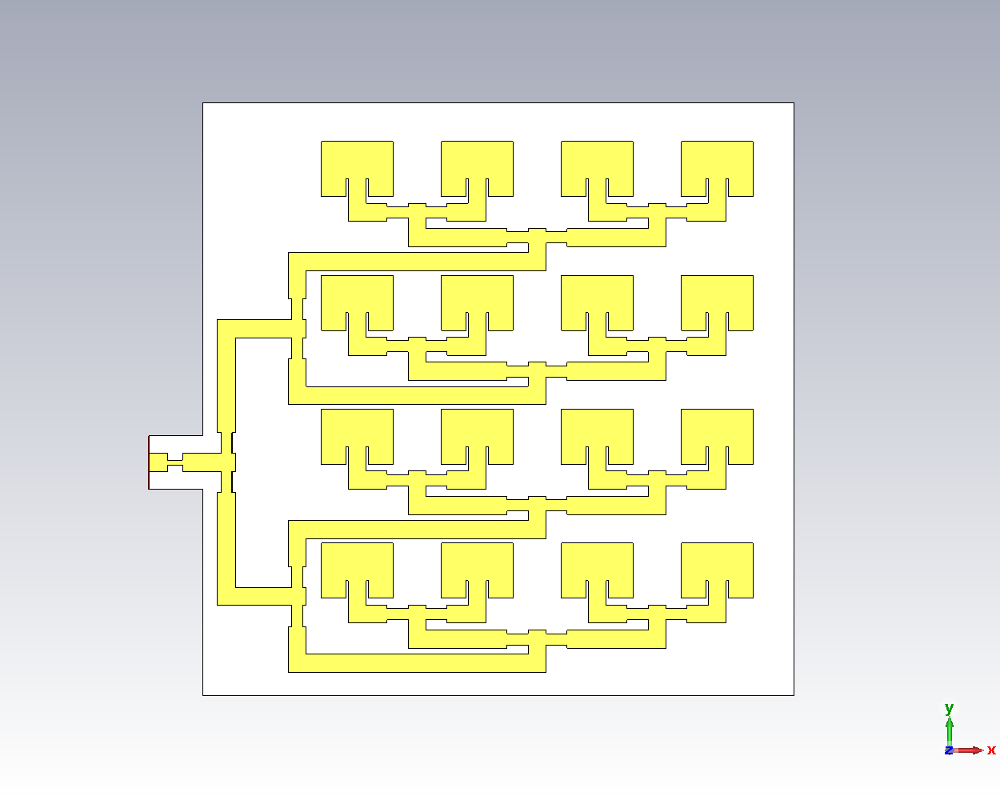

# 150 GHz 4×4 Patch Array Comparative Study

演讲后，团队先把 1×2 阵列的 Radiation Efficiency 从 71.98% 提高至 82.99%，随后在第二轮得到 85.49% 的最高效率候选。第二轮的带宽、方向图与增益权衡仍支持采用 82.99% 的第一轮设计作为课程主交付。4×4 研究在这两轮工作之后展开，用一个常规 16 单元设计检查增加孔径与馈电复杂度的取舍。研究假设是更大的物理孔径可能提高 Directivity，而损耗和失配可能限制可用实现增益。比较涵盖两个具体 CST 实现。

| 150 GHz 指标 | Optimised 1×2 | Basic 4×4 |
|---|---:|---:|
| Radiation Efficiency | 82.99% | 74.36% |
| Total Efficiency，50 Ω | 81.37% | 45.52% |
| S11，50 Ω | −17.074 dB | −4.114 dB |
| Maximum Directivity | 9.140 dBi | 12.058 dBi |
| Peak Realized Gain，50 Ω | 8.244 dBi | 8.640 dBi |
| +Z Realized Gain，50 Ω | 7.763 dBi | 7.662 dBi |
| Main Beam Offset | 16° | 6° |
| E / H HPBW | 88.22° / 48.06° | 22.50° / 25.50° |
| 包含 150 GHz 的 −10 dB 带宽 | 13.515 GHz | 无 |

4×4 扫频最低 S11 为 −9.267 dB（163.20 GHz）。它的波束更窄且更靠近 +Z，金属与介质损耗占接受功率的比例分别增加约 5.92 和 5.79 个百分点。其 50 Ω 反射功率约为 38.8%，把 Radiation Efficiency 降至 Total Efficiency 45.52%。按课程主设计所需的匹配、宽带、效率和复杂度权衡，保留 1×2。4×4 作为横向对照写入报告。

## 阅读顺序

1. [仓库首页](../README.md) 和 [演讲后研究时间线](../POST_PRESENTATION_RESEARCH_LOG.md)。
2. [设计方法](05_Documentation/Design_Methodology.md) 和 [建模、匹配与求解工作流](05_Documentation/4x4_DESIGN_AND_SIMULATION_WORKFLOW.md)。
3. [中文对比摘要](03_Comparison/Comparison_Summary.md)、[完整 CSV](03_Comparison/Array_1x2_vs_4x4_Comparison.csv) 和 [英文比较报告](05_Documentation/Comparative_Study_Report.md)。
4. [损耗分析](05_Documentation/4x4_POWER_LOSS_ANALYSIS.md)、[数值验证](05_Documentation/4x4_SIMULATION_VALIDATION.md) 和 [图表索引](Figures/FIGURE_INDEX.md)。
5. [CST 原生导出](Native_Exports/)、[试验记录](Trials/)、[复现步骤](05_Documentation/Reproduction_Guide.md) 和 [完整工程下载与 SHA256](Artifact_Manifest.md)。
6. [Final Report 写作框架](../07_Report_Handover/REPORT_WRITING_GUIDE.md#comparative-study-12-vs-44-patch-array)。
