# TELE9782 · A corporate-fed D-band patch pair at 150 GHz

## Abstract

The final array achieves **8.843 dBi peak directivity** and **7.408 dBi peak realized gain**, compared with 7.460 and 5.804 dBi for the original. Relative to the single patch these are +1.383 dB and +1.603 dB. Peak radiation intensity at the same available input power changes by a factor of 1.447. The original already met the 6.5 dBi assignment. The measured change in H-plane beamwidth is -30.96° and in E-plane width +21.26°.

Radiation efficiency changes by +0.43 percentage points and total efficiency by +3.56 points. The small nominal radiation-efficiency advantage over the original is smaller than the observed mesh variation and does not establish a robust efficiency improvement. Native S11 changes by -14.30 dB. The −10 dB bandwidth changes by +0.634 GHz. The two-patch board occupies 3.75 mm² of main ground compared with 1.96 mm² originally. An implementation aimed at peak link gain and H-plane spatial selectivity benefits from the array. The original has a smaller footprint and a simpler, straight feed. Neither result has been validated on fabricated hardware.

## Assignment and baseline

The assignment calls for a D-band microstrip antenna with directivity above 6.5 dBi. We compare a validated original single patch, a single on the larger array ground, and a single-port two-patch design at 150 GHz. The original native file and its verification record were preserved. All antenna performance values in this study are full-wave simulations.

## Array design theory

The assignment requires directivity above 6.5 dBi in 130–170 GHz. The validated single inset-fed patch supplies the starting element. Its width is 0.667 mm, its length is 0.513 mm, and its inset is 0.190 mm. We keep its metals, substrate and polarization to make a meaningful comparison at 150 GHz.

## Resonant length

The transmission-line estimate uses W = c/(2f) sqrt(2/(εr+1)), effective permittivity εeff = (εr+1)/2 + (εr−1)/(2 sqrt(1+12h/W)), and open-edge extension ΔL/h = 0.412 (εeff+0.3)(W/h+0.264) / ((εeff−0.258)(W/h+0.8)). At 150 GHz this gives W = 0.6662 mm and L ≈ 0.5204 mm. For the selected array element W = 0.667 mm, L = 0.513 mm, εeff = 3.2032 and ΔL = 0.01900 mm. The half-wave estimate c/[2(L+2ΔL)√εeff] gives **152.00 GHz**. The full assembled antenna has minimum S11 at **149.80 GHz**, a difference of 2.20 GHz (1.45% of estimate). The S11 minimum characterises impedance matching of the driven assembly. Coupled elements, bends, transformers and finite ground affect this frequency.

## Aperture and beam

Elements occupy x = ±0.6 mm with the same y coordinate and orientation. At 150 GHz λ0 = 1.9986 mm. The initial spacing of 1.00 mm corresponds to 0.500λ0. The selected 1.20 mm spacing is 0.600λ0, leaving an edge gap of 0.533 mm and a side clearance of 0.317 mm on each side. For in-phase excitations the ideal two-source array factor is 2 cos(πd sinθ cosφ/λ0). In XZ it varies with angle. In YZ it is constant. This predicts the plane most likely to narrow. All reported pattern values instead come from the full CST model with finite ground and feed scattering. Broadside y polarisation is checked using Eφ and Eθ at θ=0°, φ=0° in the angular export.

A doubled number of radiators alone does not determine the change in realized gain. Directivity normalizes angular radiation by radiated power. Multiplication by radiation efficiency and accepted-power fraction converts it to realized gain. The three-model comparison separates ground-size and excitation effects to the extent supported by one enlarged-ground control.

## Corporate-feed calculations

Two inset patch loads of nominal 50 Ω connected directly in parallel present 25 Ω. In Option A each approximately quarter-wave branch has nominal impedance √(50×100) = 70.71 Ω. Its input at the T is approximately 70.71²/50 = 100 Ω. Two transformed branches in parallel give 50 Ω. Option B would instead place a common √(25×50) = 35.36 Ω quarter-wave section before the T and run 50 Ω branches. The wider common section changes the available routing and needs independent full-wave validation. Option A met the operating-point objectives and was taken through full-wave development. Option B was evaluated analytically.

## Physical dimensions

For u = w/h, εeff uses (εr+1)/2 + (εr−1)/2 [(1+12/u)^−½ + δ], where δ = 0.04(1−u)² for u<1, else zero. For u<1, Z0 = (60/√εeff) ln(8/u+u/4). For u≥1, Z0 = 120π / [√εeff (u+1.393+0.667 ln(u+1.444))]. Solving these zero-thickness equations on the 0.040 mm polyimide gives the following starting values.

| Impedance (Ω) | Width (mm) | εeff | λg/4 (mm) |
|---:|---:|---:|---:|
| 50.00 | 0.09111 | 2.7493 | 0.30134 |
| 70.71 | 0.04943 | 2.6320 | 0.30799 |
| 100.00 | 0.02287 | 2.5257 | 0.31440 |
| 35.36 | 0.15212 | 2.8632 | 0.29529 |

The built trunk and 50 Ω outlet sections are 0.090 mm wide. The initial branches were 0.049 mm × 0.308 mm. Selected physical width × length is **0.055 × 0.280 mm**, giving 66.94 Ω and 82.1° on the quasi-static isolated-line approximation. At the junction y=-0.53 mm, the straight transformer extends along ±x and meets the 0.090 mm section. The nominal horizontal distance from T center to bend center is 0.600 mm. Both routed paths from T center to the inset endpoint are 1.038 mm on the centerline. The straight 50 Ω continuation, right-angle unmitered bends, finite metallization, and T overlap load the transformers. Narrow-line length includes the fraction overlapping the T. Electrical tuning used the complete connected antenna.

## Native modal check

| CST section at 150 GHz | Modal line Z (Ω) | CST effective permittivity | Propagation constant, raw Re + j Im | λg/4 from εeff (mm) |
|---|---:|---:|---|---:|
| Trunk | 49.431 | 2.83122 | 0 + j 5289.77 (Propagation Constant / 1/m) | 0.29695 |
| NominalTransformer | 68.585 | 2.67508 | 0 + j 5141.85 (Propagation Constant / 1/m) | 0.30549 |
| SelectedTransformer | 64.785 | 2.70160 | 0 + j 5167.27 (Propagation Constant / 1/m) | 0.30399 |

The mode-only diagnostics reuse the launch dielectric, ground, signal thickness, port aperture and final mesh settings. Only the strip width changes at the diagnostic cross-section. These uniform-line modal data describe the local line. The actual transformer is embedded between a T junction, a bend and a coupled patch load. Paired complex Ez exports compare the two loaded arms at equal physical reference planes.

## CST implementation

The parameterized construction joins two slotted gold patches, two outlet lines, two bends and both horizontal transformers to one signal solid named `antenna:trunk`. The signal conductor sits at z=0.040–0.042 mm. The common ground at z=−0.002–0 mm is electrically separate. Polyimide fills the intervening 0.040 mm. The ground and polyimide each include the 0.50 × 0.50 mm launch. Main ground is 2.50 × 1.50 mm. Gold uses σ=4.561×10⁷ S/m and Polyimide εr=3.5, tanδ=0.0027 referenced at 150 GHz. The inset depth is 0.165 mm and each side clearance 0.020 mm. Dimensions and solid names are available in `parameters.json` and `Tree.json`.

One physical, single-mode microstrip waveguide port is located at y=−1.250 mm and faces inward along +y. Its aperture spans x=±0.25 mm, z=−0.002 to 0.240 mm. Solver settings are TD-S, hexahedral mesh with PBA, 130–170 GHz, energy decay target −60 dB, open radiation boundaries, quarter-wavelength open-space reference at 130 GHz, and the global enclosing farfield surface. The delivered native S1,1 trace has a solved reference of 49.4310 Ω. The original single's native reference is 49.4686 Ω and the final physical trunk's modal impedance appears in Port_Mode_Check.json. `AutoNormImpedance=False` in the original and screening histories. The production history explicitly requests AutoNormImpedance=True and NormingImpedance=50. Reading the saved project nevertheless shows an unchanged modal-reference S1,1. The independently verified CST Touchstone export is the authoritative fixed-50-Ω trace. The common 50 Ω comparison uses Zin=Zref(1+Γ)/(1−Γ) and Γ50=(Zin−50)/(Zin+50). Common-reference realized gain uses D×ηrad×(1−|Γ50|²).

Field monitors store E/H/current at 150 GHz and 13 farfields at 130, 140, 146–154, 160 and 170 GHz. The 2° full-sphere exports sample total directivity. At θ=0°, φ=0°, Eφ and Eθ are 8.84 and -77.42 dBi. Eφ points along y here. E-plane comparisons use YZ and H-plane comparisons use XZ. Signed positive angles point toward +y and +x respectively. Native model views and field exports are in `02_Simulation_Results`.

The original 04_Automation directory was absent in this local final package. The construction and result readers derive from the previously published project automation copy. An enlarged-ground control rebuilds the single original patch with its 0.513 mm length, 0.190 mm inset and straight feeder. Extending the board length also increases its straight feed by 0.050 mm. Differences between control and array include the feed, element retuning and mutual fields.

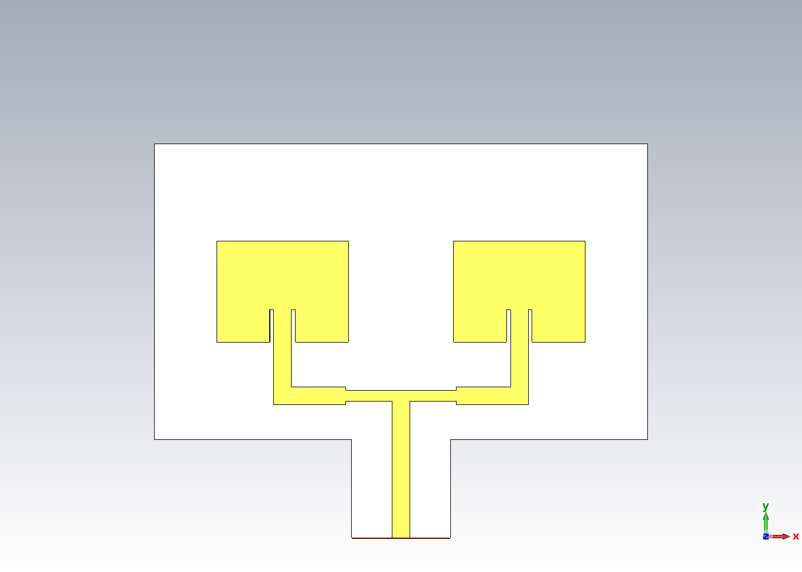

## Parameter optimization

| Case | d mm | L mm | Inset mm | Wt mm | Lt mm | Cells | S11 dB | D dBi | Greal dBi |
|---|---|---|---|---|---|---|---|---|---|
| Final50 | 1.200 | 0.513 | 0.165 | 0.055 | 0.280 | 474240.000 | -27.153 | 8.841 | 7.456 |
| Fine | 1.000 | 0.507 | 0.165 | 0.055 | 0.280 | 215004.000 | -12.087 | 8.867 | 7.425 |
| GroundControl |  | 0.513 | 0.190 |  |  | 186576.000 | -27.320 | 7.963 | 6.614 |
| Initial | 1.000 | 0.513 | 0.190 | 0.049 | 0.308 | 95285.000 | -8.819 | 8.469 | 6.471 |
| Inset | 1.000 | 0.507 | 0.165 | 0.049 | 0.308 | 93670.000 | -13.976 | 8.846 | 7.506 |
| Length | 1.000 | 0.507 | 0.190 | 0.049 | 0.308 | 95285.000 | -10.710 | 8.729 | 7.065 |
| MeshHoldout | 1.200 | 0.513 | 0.165 | 0.055 | 0.280 | 523614.000 | -29.359 | 8.850 | 7.470 |
| Refined | 1.200 | 0.513 | 0.165 | 0.055 | 0.280 | 474240.000 | -27.153 | 8.841 | 7.456 |
| RetunedFine | 1.200 | 0.513 | 0.165 | 0.055 | 0.280 | 218776.000 | -13.045 | 9.074 | 7.598 |
| Spacing110 | 1.100 | 0.507 | 0.165 | 0.055 | 0.280 | 97527.000 | -11.966 | 8.999 | 7.519 |
| Spacing120 | 1.200 | 0.507 | 0.165 | 0.055 | 0.280 | 102011.000 | -8.955 | 9.175 | 7.323 |
| Spacing120_Retuned | 1.200 | 0.513 | 0.165 | 0.055 | 0.280 | 103740.000 | -16.255 | 9.050 | 7.650 |
| Spacing130 | 1.300 | 0.507 | 0.165 | 0.055 | 0.280 | 95285.000 | -8.482 | 9.273 | 7.332 |
| Spacing90 | 0.900 | 0.507 | 0.165 | 0.055 | 0.280 | 95285.000 | -24.337 | 8.592 | 7.448 |
| Transformer | 1.000 | 0.507 | 0.165 | 0.055 | 0.280 | 97527.000 | -17.592 | 8.809 | 7.574 |

Candidate selection first required S11 ≤ −10 dB at 150 GHz, then ranked peak realized gain. This selected screening case Transformer. Subsequent angular, power and mesh checks test whether this scalar choice is defensible. The solver models complete routes with square bends, nominally quarter-wave transformer arms and the real dielectric and metal losses.

## Fixed-frequency comparison

| Metric | Original | Enlarged single | Final array | Array − original |
|---|---|---|---|---|
| Dmax_dBi | 7.460 | 7.963 | 8.843 | 1.383 |
| D_broadside_dBi | 7.428 | 7.686 | 8.841 | 1.413 |
| realized_gain_dBi | 5.804 | 6.614 | 7.408 | 1.603 |
| S11_dB | -13.424 | -27.320 | -27.727 | -14.303 |
| S11_50_dB | -13.476 | -27.043 | -27.802 | -14.327 |
| realized_50_dBi | 5.807 | 6.614 | 7.408 | 1.601 |
| rad_eff_pct | 71.553 | 73.429 | 71.981 | 0.428 |
| total_eff_pct | 68.301 | 73.293 | 71.860 | 3.559 |
| fmin_GHz | 148.840 | 149.880 | 149.800 | 0.960 |
| f_low_GHz | 147.106 | 148.160 | 147.596 | 0.490 |
| f_high_GHz | 150.619 | 151.630 | 151.743 | 1.124 |
| BW_GHz | 3.513 | 3.470 | 4.147 | 0.634 |
| FBW_percent | 2.360 | 2.315 | 2.771 | 0.411 |
| E_HPBW_deg | 83.266 | 74.448 | 104.529 | 21.262 |
| H_HPBW_deg | 74.010 | 74.956 | 43.051 | -30.959 |
| theta_deg | 4.000 | 10.000 | 2.000 | -2.000 |
| phi_deg | 264.000 | 268.000 | 82.000 | -182.000 |

Footprint including the launch is 2.21 mm² (original) and 4.00 mm² (array). The main beam lies 2° from +z at φ=82° on the sampled array sphere. Broadside realized gain is 7.406 dBi. Among several near-equal angular samples, peak azimuth is precision-sensitive near the pole. The E-plane −3 dB crossings are -47.24° and 57.29°. H-plane crossings are -21.52° and 21.53°, interpolated between adjacent 2° samples relative to each cut's own peak. Angular CSVs retain all rear lobes and nulls. The plots clip the ordinate below their displayed floor.

Changing only the single-patch board size and feed extension changed peak directivity by +0.503 dB and realized gain by +0.810 dB. Adding the complete two-patch design on that board changed them by a further +0.880 and +0.794 dB. This control identifies the board contribution with the single radiator. Interactions make a unique element-only decomposition impossible.

The original and array dissipate respectively 0.08954 and 0.08528 W in metal, and 0.04264 and 0.04113 W in dielectric, at the common 0.5 W stimulated normalization. The solver records whole-antenna dissipation. It does not isolate T-junction loss. The feed and coupling change input impedance and stored fields. Distinct dissipation and mismatch contributions can therefore move in different directions.

## Handpicked operating point versus extrema

| design | criterion | f_GHz | S11_dB | Dmax_dBi | realized_gain_dBi |
|---|---|---|---|---|---|
| Original single patch | Best realized gain among matched monitors | 149.000 | -30.146 | 7.410 | 5.982 |
| Original single patch | Highest gain among all monitors | 149.000 | -30.146 | 7.410 | 5.982 |
| Original single patch | Highest directivity among all monitors | 154.000 | -3.444 | 7.570 | 3.088 |
| Single on array ground | Best realized gain among matched monitors | 150.000 | -27.320 | 7.963 | 6.614 |
| Single on array ground | Highest gain among all monitors | 150.000 | -27.320 | 7.963 | 6.614 |
| Single on array ground | Highest directivity among all monitors | 151.000 | -13.495 | 7.970 | 6.404 |
| Corporate-fed array | Best realized gain among matched monitors | 149.000 | -17.996 | 8.950 | 7.515 |
| Corporate-fed array | Highest gain among all monitors | 149.000 | -17.996 | 8.950 | 7.515 |
| Corporate-fed array | Highest directivity among all monitors | 140.000 | -2.871 | 9.224 | 4.351 |

The selection criterion above uses realized gain at genuinely simulated monitors satisfying S11 ≤ −10 dB. The lowest broadband S11 occurs at 148.84 GHz (single) and 149.80 GHz (array). The two selections and the minima answer different questions. Lines on frequency plots connect discrete farfield monitor solutions.

## Spacing, coupling and excitation

| case | spacing_mm | Zre150_ohm | Zim150_ohm | fmin_GHz | H_HPBW_deg | left_patch_Krms_A_per_m | right_patch_Krms_A_per_m |
|---|---|---|---|---|---|---|---|
| Spacing90 | 0.900 | 55.184 | -3.246 | 150.120 | 53.124 | 57.243 | 57.153 |
| Transformer | 1.000 | 40.821 | -8.012 | 151.040 | 49.594 | 54.561 | 54.475 |
| Spacing110 | 1.100 | 29.821 | -2.603 | 151.880 | 46.250 | 52.230 | 52.179 |
| Spacing120 | 1.200 | 23.898 | 5.225 | 152.320 | 43.212 | 48.805 | 48.819 |
| Spacing130 | 1.300 | 24.689 | 13.589 | 152.120 | 40.557 | 49.644 | 49.573 |
| 02_Simulation_Results | 1.200 | 49.801 | -4.063 | 149.800 | 43.051 | 198.452 | 199.322 |

The coarse spacing comparison retains common ground, inset, transformer and vertical feed dimensions. Increasing spacing lengthens each horizontal 50 Ω continuation by half the change in spacing. The measured change in Zin, resonance, current and radiation therefore includes mutual fields and routing changes. A one-port antenna has no independent external element-to-element S21. The exported local Ez values originate at four matched reference-plane pairs 0.020 mm above the ground. The maximum absolute final right/left amplitude difference is **0.0026 dB**, and phase difference **0.034°**. These are loaded local field ratios. They support balanced excitation without assigning independently calibrated forward powers to the branches. The current table averages |K|² over equal central patch rectangles, using the native facet areas at the top metal surface.

Among the final forward cut samples, the strongest additional local maximum relative to the H-cut peak is -17.16 (dB if present). The E-cut value is absent. These checks apply to the sampled principal cuts. The global maximum and full 3D sphere also establish the main-beam direction.

### Resonance retuning and the production choice

The 1.20 mm screening case gave 9.175 dBi and -8.96 dB S11 at 150 GHz. Increasing its patch length to 0.513 mm produced 9.050 dBi, 7.650 dBi realized gain and -16.25 dB S11 on the same coarse grid. The finer-grid comparison selected **Refined** as the physical production source. The Final50 production source retained its geometry and resolution. The jump from 218,776 to 474,240 cells changed peak directivity by 0.233 dB and the minimum-S11 frequency by 1.56 GHz. An independently solved 38/57 holdout grid checks the stability of the 36/54 production mesh. Mesh_Convergence.csv contains every grid on this geometry, including the earlier nonmonotonic shift. Independently re-referencing the freshly solved broadband trace to 50 Ω recovers the CST-native 50 Ω Touchstone export with maximum complex reflection error 6.9088e-08.

### Common 50 Ω reference, 150 GHz

| Design | S11 dB | D dBi | Greal dBi | ηrad % | ηtotal % |
|---|---|---|---|---|---|
| Original | -13.476 | 7.460 | 5.807 | 71.553 | 68.339 |
| Enlarged ground | -27.043 | 7.963 | 6.614 | 73.429 | 73.284 |
| Final array | -27.802 | 8.843 | 7.408 | 71.981 | 71.862 |

### Final array monitor samples

| GHz | S11 dB | D dBi | Greal dBi | ηrad % | ηtotal % |
|---|---|---|---|---|---|
| 130.000 | -1.716 | 9.012 | 1.572 | 55.241 | 18.028 |
| 140.000 | -2.871 | 9.224 | 4.351 | 67.317 | 32.561 |
| 146.000 | -6.502 | 9.156 | 6.705 | 73.252 | 56.862 |
| 147.000 | -8.355 | 9.105 | 7.088 | 73.608 | 62.857 |
| 148.000 | -11.493 | 9.038 | 7.385 | 73.575 | 68.358 |
| 149.000 | -17.996 | 8.950 | 7.515 | 73.030 | 71.871 |
| 150.000 | -27.727 | 8.843 | 7.408 | 71.981 | 71.860 |
| 151.000 | -13.955 | 8.717 | 7.021 | 70.500 | 67.664 |
| 152.000 | -9.021 | 8.581 | 6.364 | 68.616 | 60.020 |
| 153.000 | -6.281 | 8.442 | 5.491 | 66.304 | 50.693 |
| 154.000 | -4.598 | 8.307 | 4.491 | 63.590 | 41.530 |
| 160.000 | -1.482 | 7.379 | -1.277 | 47.144 | 13.626 |
| 170.000 | -0.842 | 4.863 | -7.378 | 33.863 | 5.969 |

These are maxima over angle at each stated monitor frequency. The 150 GHz fixed comparison uses independently calculated angular cuts and broadside data. The broadband S11 trace has 1001 samples.

## Comparison figures

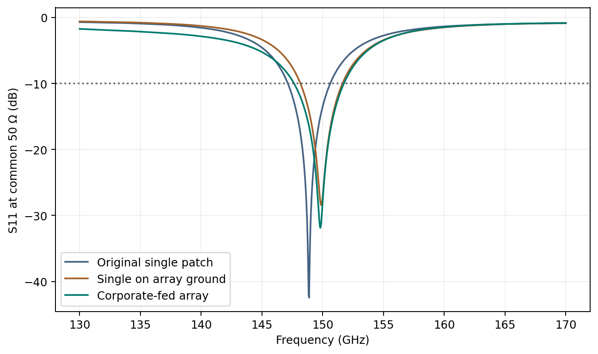

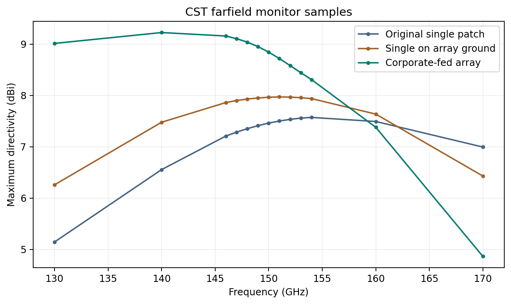

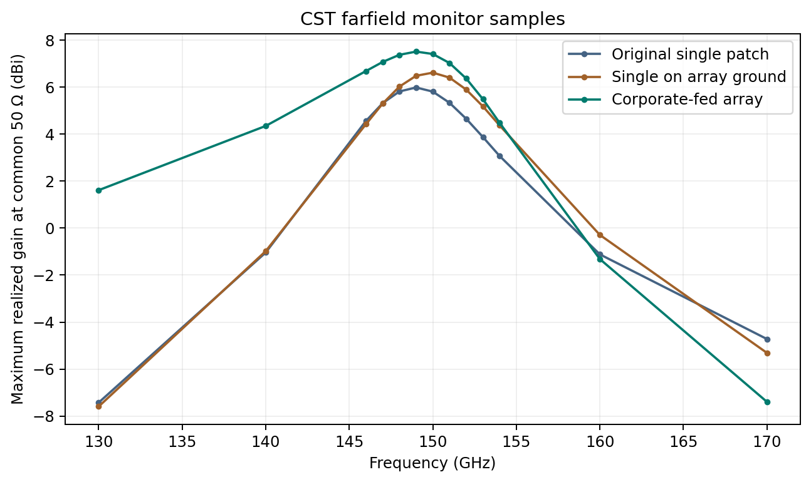

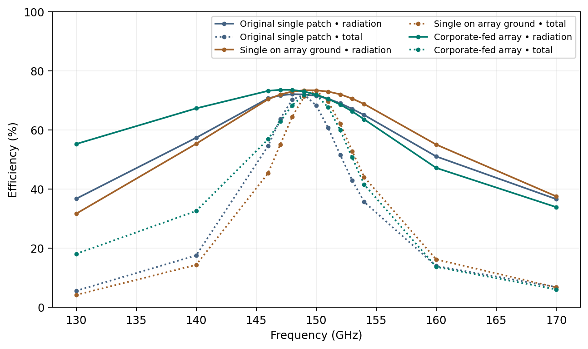

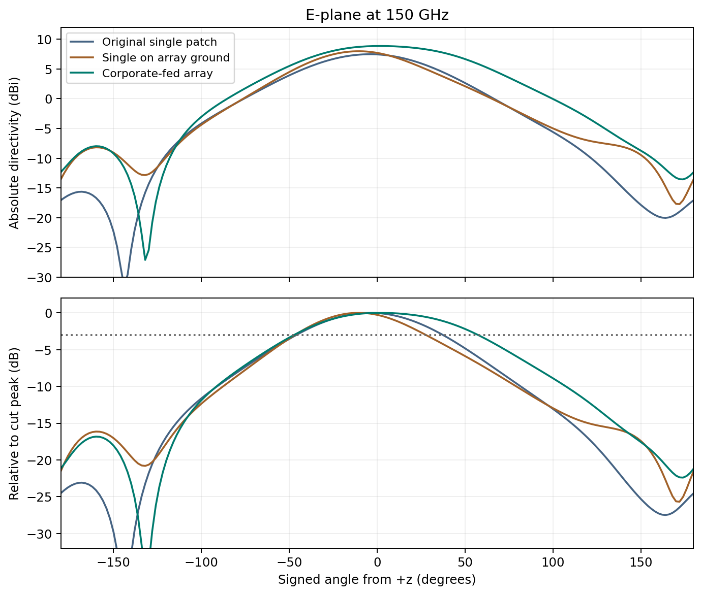

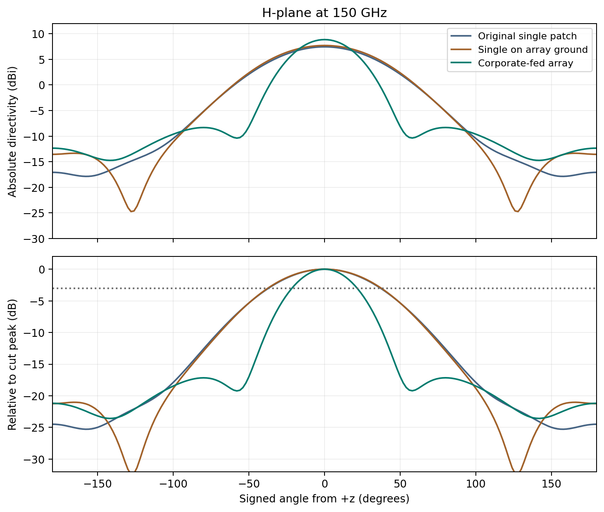

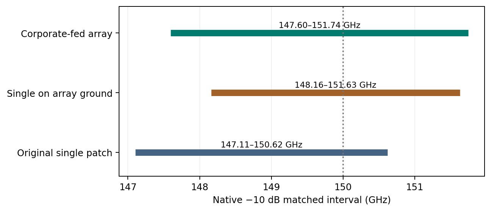

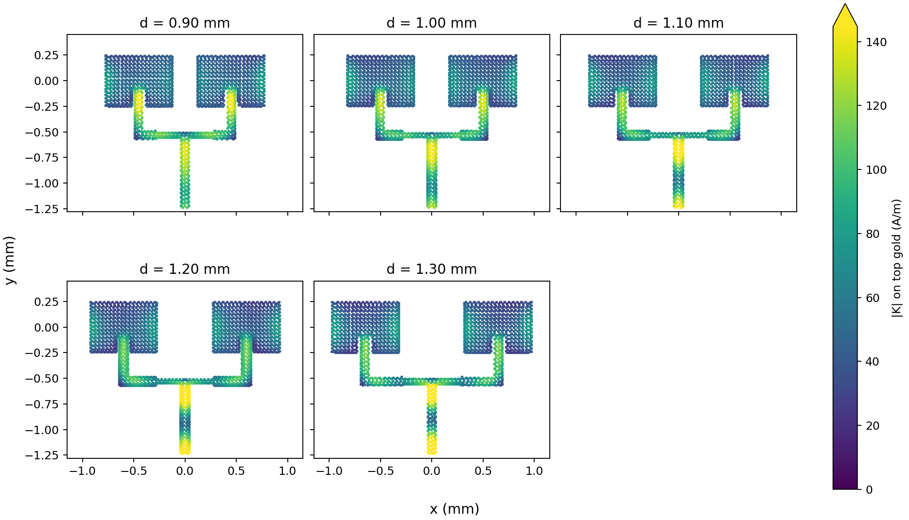

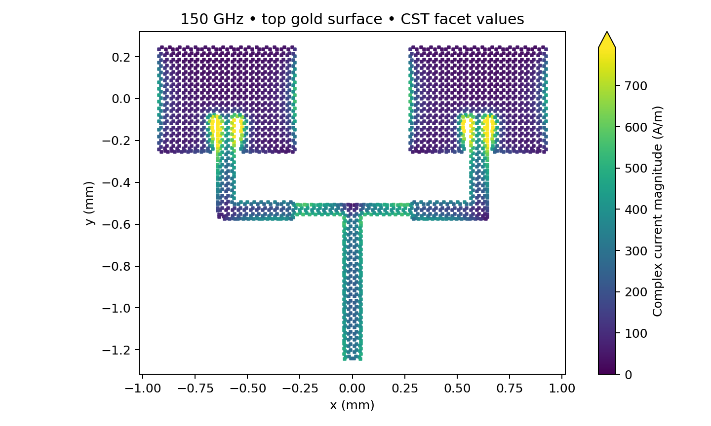

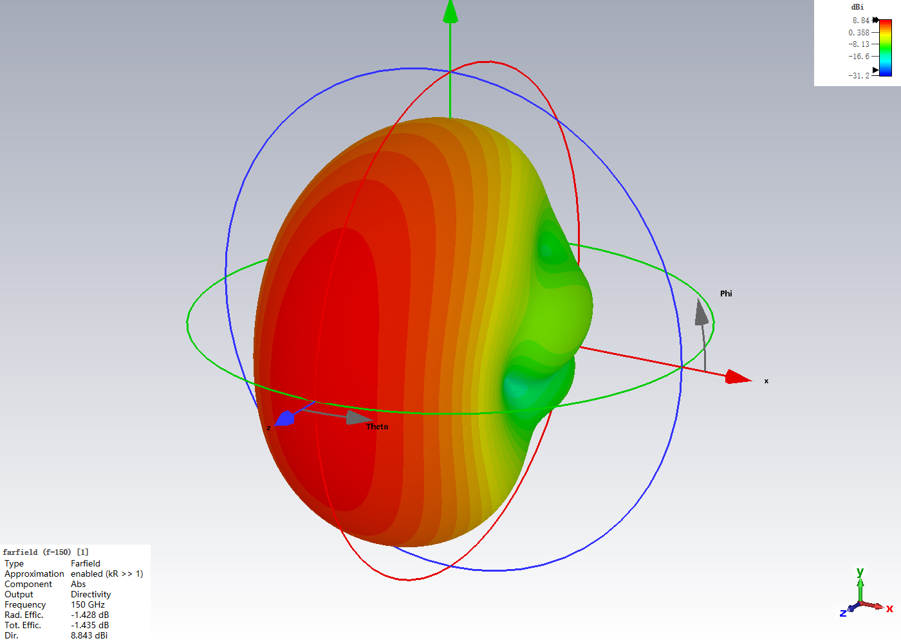

## Numerical validation

The delivered model was saved with native results, closed, opened from its final pathname, freshly solved, closed and opened again. Parameters were compared with the selected build. One port and 13 farfield monitors were found. CST returned **SUCCESS**. The full S11 trace has 1001 samples. Maximum complex differences were 0 on initial reopen, 0.00702 after fresh solve, 0 on second reopen, and 0 between the exported CSV and reopened trace. Peak directivity across all 13 monitors changed by at most 0.0079415 dB on rerun. At 150 GHz the fresh solve moves peak directivity by +0.00194 dB, realized gain by −0.04791 dB and the S11 minimum by one 0.04 GHz sample. The solver log records that the repeat reused the prior port-adaptation result. The differences exceed the initial very tight software repeatability check. Their exact numerical cause has not been isolated. Opening the completed project reads back the saved trace exactly. All final figures use the fresh solve.

## Same-geometry mesh sensitivity

| Mesh | Cells | Steps/wave | Steps/box | fmin GHz | S11 dB | D dBi | Greal dBi | ηrad % |
|---|---|---|---|---|---|---|---|---|
| Spacing120_Retuned | 103740.000 | 20.000 | 30.000 | 150.920 | -16.255 | 9.050 | 7.650 | 74.208 |
| RetunedFine | 218776.000 | 30.000 | 45.000 | 151.320 | -13.045 | 9.074 | 7.598 | 74.903 |
| Refined | 474240.000 | 36.000 | 54.000 | 149.760 | -27.153 | 8.841 | 7.456 | 72.829 |
| MeshHoldout | 523614.000 | 38.000 | 57.000 | 149.840 | -29.359 | 8.850 | 7.470 | 72.863 |

Between the two densest grids, the absolute changes were 0.0088 dB in directivity at 150 GHz, 0.0142 dB in realized gain, 0.034 points in radiation efficiency, and 0.053% in minimum-S11 frequency. The indicative limits of 0.2 dB for directivity and 1% in resonance are both met. The matched-band edges and depth of a narrow S11 minimum remain mesh-sensitive. Finite mesh precision is separate from fabrication uncertainty.

## Power, passivity and angular normalization

CST incident, reflected, accepted and radiated powers at 150 GHz are 0.500000, 0.000844, 0.499156 and 0.359298 W. Gold and dielectric dissipation are 0.085280 and 0.041134 W. Accepted minus radiated and dissipated power is +0.013444 W, or +2.693% of accepted power. The largest |S11| in the native broadband sweep is 0.907589. The realized-gain identity residual at 150 GHz is +0.000000 dB.

The 2° full-sphere export was converted from dBi to linear directivity, weighted by sinθ, closed periodically in φ, and integrated by the trapezoidal rule. Its mean over 4π is 0.987345, discrepancy 1.265%. The calculation uses the unscaled angular samples. `Power_Balance.csv` gives per-monitor values. CST loss curves in the raw export may have coarser frequency sampling than S11. Interpolated power checks away from native loss samples have lower evidential weight than the 150 GHz check.

Final CST warning messages: 1 warning occurred., This software is licensed for non-commercial use only.. The commercial-use notice describes licensing. Solver completion, power residual and sphere integration are checked independently.

## Port absorption and the complete power budget

At 150 GHz, counting radiation and dissipated power in gold and polyimide leaves 0.013444 W (2.693% of accepted power). The separate CST curve *Power Absorbed at all Ports* contributes 0.011725 W (2.349% of accepted power). The installed CST 2024 Help, *Power View → Power Absorbed at all Ports*, identifies this term as absorption by the waveguide-port boundary of field components outside the specified modal basis. It is distinct from outgoing fundamental-mode power and from material dissipation. The native curve is included as an independent export. The complete residual Paccepted − Prad − Pmetal − Pdielectric − Pport,abs is **+0.001720 W, or +0.345%**. No efficiency or farfield has been rescaled.

The single excited quasi-TEM mode remains the definition of the electrical input. The absorbed fraction quantifies another limitation of the finite launch and modeled port. The geometry, selected mode and unused-mode treatment were held consistent across the physical comparison. The reported radiation and total efficiencies retain this absorbed power in their denominators. See Power_Closure_By_Mesh.csv for both budgets on the selected meshes and ground controls.

## Limitations

Gold conductivity and constant substrate permittivity and loss tangent are engineering inputs. Surface roughness, process tolerances, packaging, connector transitions and measured D-band material dispersion were not characterized. An individual arm has a nominal quarter-wave design. Its embedded impedance is influenced by loading. The common-reference calculation does not move the port plane. The matched interval covers part of 130–170 GHz. Sparse farfield monitors support conclusions at their sampled frequencies. Nominal geometric symmetry alone is insufficient to establish balance, hence the complex field comparison.

## Conclusion

For the 150 GHz enhancement study, the narrower H-plane beam and simulated peak realized-gain increase of 1.60 dB quantify the return on a larger, more complex board. For a submission whose sole requirement is directivity above 6.5 dBi, the original single element remains sufficient.
