# TELE9782 · D-band 1×2 阵列辐射效率优化

## 结论与评价口径

老师指出原单贴片的 71.55% 辐射效率偏低。此前 1×2 阵列在 150 GHz 的效率为 71.981%。本研究以真实 Gold 和原 Polyimide 进行几何优化。最终项目从交付路径重开并重新求解后，辐射效率为 **82.994%**，相对旧阵列变化 **+11.013 个百分点**。共同 50 Ω 的 S11 为 **-17.074 dB**，峰值方向性 **9.140 dBi**，实现增益 **8.244 dBi**。两套高分辨率网格和独立复算均支持 80% 目标。 建议在此仿真设计空间内采用最终项目。

所有指标取自 150 GHz 实际监视频点。ηrad=Prad/Pacc，ηm,50=1−|Γ50|²，ηtot,50=ηrad×ηm,50，Greal,50=Dmax+10log10(ηtot,50)。功率分解保持 CST 激励波的原生口径。固定 50 Ω 只影响反射、失配和实现增益的统一比较。功率未重新分配。表中 eta 和 eta_total50 的单位为 %，S11_50 为 dB，D/G50 为 dBi，bandwidth50 为 GHz，各个 P 为 W。

## 完整基线与功率核查

使用 07 下最终原生 .cst 和同名伴随目录的完整副本。Native_Provenance.json 对照文件内容并从 cst.results 直接读取七条功率结果。原生 S 参数采用约 49.431 Ω。备份工程的入射、反射、接受、辐射功率分别为 0.500000、0.000844、0.499156、0.359298 W。金属、介质及端口吸收分别为 0.085280、0.041134、0.011725 W。闭合残差为 0.345% 的接受功率。原生场、S11、方向性及损耗原始曲线保存在各工程目录；同阻抗归一、波束宽度、损耗占比和比较图来自后处理。

## 材料损耗分离

A/B/C/D 都从同一验证工程克隆，在相同筛选网格参数分别重新求解。PEC 作用于信号导体与地；无损介质仅把 tanδ 设为零，保留 εr 与厚度。空的理想损耗通道仅在该材料本身无损且 CST 未生成对应曲线时记零。

| name | cells | eta | S11_50 | D | G50 | Pmetal | Pdiel | Pport | residual_pct |
|---|---|---|---|---|---|---|---|---|---|
| A_Gold_PI | 103740.000 | 74.208 | -16.096 | 9.050 | 7.647 | 0.073 | 0.039 | 0.010 | 0.999 |
| B_PEC_PI | 103740.000 | 87.789 | -13.073 | 9.115 | 8.330 | 0.000 | 0.043 | 0.011 | 0.982 |
| C_Gold_NoTanD | 103740.000 | 80.890 | -15.865 | 9.064 | 8.029 | 0.078 | 0.000 | 0.010 | 1.067 |
| D_PEC_NoTanD | 103740.000 | 96.527 | -12.341 | 9.128 | 8.714 | 0.000 | 0.000 | 0.011 | 1.053 |

相对同网格 A，单独 PEC 的效率改变 +13.580 点，单独无损介质改变 +6.682 点，二者同时理想化改变 +22.319 点。比较支持优先研究导体损耗。材料变化也改变输入阻抗、表面电流和分配给各损耗通道的功率。D 给出本模型的理想化诊断上限；三个理想化结果均排除于最终选型之外。

## 馈电结构与匹配

中心线对称，从单一输入端口经 T 结、变压段与弯折到两片 inset。F1 同时减少支路横向跨度并把结点向贴片移动；从端口到结点的共用主干随之加长，整个效果包含新电流分布与互耦。F2 测试较宽且较短的变压段，F3 在两个外角对称削角，F4 还在 T 结内角填入小金属三角。需要时对长度和 inset 调谐。物理端口平面、主地板和边界设置保持与基线一致。下列全部候选都由 CST 完整求解。

| name | array_spacing | junction_y | transformer_width | transformer_length | inset_length | eta | S11_50 | D | G50 | Pmetal |
|---|---|---|---|---|---|---|---|---|---|---|
| F1_ShortArms | 1.120 | -0.405 | 0.055 | 0.280 | 0.165 | 77.117 | -16.058 | 9.173 | 7.935 | 0.067 |
| F2_WideTransformer | 1.120 | -0.405 | 0.066 | 0.240 | 0.165 | 76.897 | -12.202 | 9.179 | 7.768 | 0.064 |
| F3_Miter | 1.120 | -0.405 | 0.066 | 0.240 | 0.165 | 76.799 | -12.030 | 9.182 | 7.755 | 0.064 |
| F4_Tee | 1.120 | -0.405 | 0.066 | 0.240 | 0.165 | 76.818 | -11.385 | 9.183 | 7.710 | 0.064 |

用于下一阶段的馈电几何取自 **F1_ShortArms**。排序先排除失配、方向性低于门槛、严重偏轴或功率闭合异常的候选，再比较辐射效率及增益。未将失配时的高效率峰值纳入最终结论。

## 基板与真实金属厚度

h 变化时，信号金属随基板顶面移动，端口 z 截面仍为 −t 至 6h，馈线与变压线宽度按 h 缩放，贴片长度根据边缘延伸调整，再根据实际匹配谷调谐。面内物理端口位置和参考面未移动。厚度和匹配参数同时改变时，数据代表完整可用设计的性能。对比同一组几何上的 2/3/5 μm Gold 可单独考察金属厚度。σ=4.561×10⁷ S/m，150 GHz 的经典趋肤深度约 0.192 μm。2 μm 已超过十个趋肤深度；进一步加厚的仿真变化还包含表面阻抗、边缘场和网格表示的影响。

| name | substrate_h | metal_thickness | patch_length | feed_width | inset_length | eta | S11_50 | D | G50 | Pmetal | Pdiel | Rin | Xin | fmin50 |
|---|---|---|---|---|---|---|---|---|---|---|---|---|---|---|
| Au3um | 0.075 | 0.003 | 0.515 | 0.169 | 0.165 | 84.572 | -14.415 | 9.179 | 8.291 | 0.034 | 0.025 | 50.154 | 19.405 | 152.840 |
| Au5um | 0.075 | 0.005 | 0.515 | 0.169 | 0.165 | 82.483 | -13.595 | 8.958 | 7.928 | 0.038 | 0.030 | 75.837 | 5.055 | 148.400 |
| H30 | 0.030 | 0.002 | 0.519 | 0.068 | 0.165 | 68.903 | -15.991 | 9.198 | 7.470 | 0.102 | 0.042 | 61.539 | 13.588 | 149.360 |
| H50 | 0.050 | 0.002 | 0.506 | 0.113 | 0.165 | 81.157 | -13.322 | 9.160 | 8.046 | 0.048 | 0.030 | 35.697 | 11.994 | 152.280 |
| H60 | 0.060 | 0.002 | 0.500 | 0.135 | 0.165 | 84.060 | -10.799 | 9.217 | 8.085 | 0.033 | 0.025 | 29.203 | 9.877 | 154.800 |
| H60_Length | 0.060 | 0.002 | 0.518 | 0.135 | 0.165 | 82.251 | -14.110 | 8.950 | 7.929 | 0.043 | 0.030 | 67.146 | 15.757 | 148.480 |
| H75 | 0.075 | 0.002 | 0.490 | 0.169 | 0.165 | 86.003 | -9.100 | 9.322 | 8.097 | 0.025 | 0.022 | 25.703 | 11.441 | 156.680 |
| H75_Length | 0.075 | 0.002 | 0.515 | 0.169 | 0.165 | 84.571 | -14.511 | 9.177 | 8.293 | 0.034 | 0.025 | 50.350 | 19.218 | 152.760 |

基板侧缘内侧 0.03、0.06、0.09 mm、z=h/2 的 Ez 幅度按接受功率归一，下表亦列全空间远场 70–110° 天顶角范围的辐射份额。这两个量反映近边缘场和低仰角辐射的变化；包含空间辐射与边缘衍射，不能唯一给出某个表面波模的功率。

| case | h_mm | edge_Ez_RMS_Vm_per_sqrtW | near_horizon_radiated_fraction_70_to_110_deg | theta_deg |
|---|---|---|---|---|
| A_Gold_PI | 0.040 | 2583.565 | 0.133 | 2.000 |
| H30 | 0.030 | 1249.329 | 0.118 | 2.000 |
| H50 | 0.050 | 1109.924 | 0.124 | 8.000 |
| H60 | 0.060 | 1306.128 | 0.126 | 12.000 |
| H75 | 0.075 | 1672.118 | 0.132 | 16.000 |

本轮保持 Polyimide 的 εr=3.5、tanδ=0.0027。对这一材料组合已有明确的效率变化依据，未以低频材料规格替代 D-band 实测数据。工艺上的薄膜厚度、粗糙度、介质各向异性与温度变化仍需实测。

## 最终工程与功率变化

最终阵列间距 1.120 mm，每片 0.667 × 0.5148 mm，inset 深度 0.1650 mm，基板厚 0.075 mm，Gold 厚 2.0 μm。主馈线宽 0.1688 mm，变压段 0.1031 × 0.280 mm；T 结位置 y=-0.405 mm。miter=False，T 三角补偿=False。库内所有架构保持单端口和实体相连的信号体，实际表面电流和左右馈点场用于最终核查。

| name | eta | eta_total50 | S11_50 | D | G50 | bandwidth50 | E_HPBW_deg | H_HPBW_deg |
|---|---|---|---|---|---|---|---|---|
| Original Single Patch | 71.553 | 68.339 | -13.476 | 7.460 | 5.807 | 3.490 | 83.266 | 74.010 |
| Enlarged-Ground Single Patch | 73.429 | 73.284 | -27.043 | 7.963 | 6.614 | 3.460 | 74.448 | 74.956 |
| Previous 1x2 Array | 71.981 | 71.862 | -27.802 | 8.843 | 7.408 | 4.107 | 104.529 | 43.051 |
| TELE9782_DBand_Efficiency_Final | 82.994 | 81.366 | -17.074 | 9.140 | 8.244 | 13.515 | 88.217 | 48.062 |

以接受功率为分母的百分比分解如下。

| case | radiated_pct | metal_pct | dielectric_pct | port_pct | residual_pct |
|---|---|---|---|---|---|
| 01_CST_Project | 71.981 | 17.085 | 8.241 | 2.349 | 0.345 |
| TELE9782_DBand_Efficiency_Final | 82.994 | 7.954 | 5.569 | 3.126 | 0.356 |

相对旧阵列，金属耗散占比变化 -9.130 点，介质耗散占比变化 -2.671 点，端口吸收占比变化 +0.777 点。各项功率的实际变化解释了效率的净改进。较宽的馈线、基板厚度改变引起的导体电流和介质储能变化是物理解释，数据仅能直接分解整副天线的损耗，无法从单端口总功率唯一分配 T 结和每个弯折的局部损耗。

最终 50 Ω 匹配带 **141.139–154.654 GHz**。较旧阵列带宽变化 +9.408 GHz，方向性 +0.297 dB，实现增益 +0.837 dB。主峰 θ=16°、φ=90°，2° 角度采样。E/H 面半功率宽度分别为 88.22°、48.06°。次级前向局部峰相对各切面主峰，E 面 None、H 面 None dB；None 表示该采样切面没有额外局部最大值。

## 数值验证与端口近似

| name | cells | eta | S11_50 | D | G50 | fmin50 | sphere_mean | residual_pct |
|---|---|---|---|---|---|---|---|---|
| H75_Length | 100920.000 | 84.571 | -14.511 | 9.177 | 8.293 | 152.760 | 0.999 | 1.032 |
| Fine | 574464.000 | 83.438 | -17.000 | 9.136 | 8.263 | 150.680 | 1.001 | 0.357 |
| IndependentMesh | 601128.000 | 83.519 | -16.912 | 9.141 | 8.269 | 150.800 | 1.000 | 0.345 |
| TELE9782_DBand_Efficiency_Final | 574464.000 | 82.994 | -17.074 | 9.140 | 8.244 | 150.720 | 1.001 | 0.356 |

两套高分辨率几何相同。效率相差 0.081 点、方向性 0.004 dB、实现增益 0.007 dB，匹配最低点相差 0.120 GHz。生产工程含结果另存后关闭重开，执行全新求解，再次关闭重开。求解状态 SUCCESS。原生复数 S11 在第一次重开、全新求解、最终重开时的最大全带差依次为 0、0.004807、0。最终 CST 原生固定 50 Ω Touchstone 与独立换算的最大复数误差为 6.99e-08。

CST 基线日志指明端口模式求解器在 150 GHz 以常量近似色散材料并忽略截面模态求解中的损耗项。体求解仍保留真实 σ 和 tanδ。PortFrequency140 在相同几何和筛选网格仅将端口模式计算频率移至 140 GHz，继续读取 150 GHz 辐射结果，未移动或扩大物理端口。相对 H75_Length，效率变化 +0.059 点、S11 变化 -0.031 dB、端口吸收变化 -0.000205 W。该诊断的原生日志同时记录 F-Calc 140 和材料常量近似仍在 150 GHz 取值。它只检验端口模式计算频率敏感性，不能代替显式含损耗的独立端口本征模求解。重复求解的差异亦列于 verification.json。

最终球面方向性线性积分均值 1.00071。输入 0.500000 W，反射 0.007767 W，接受 0.492233 W，辐射 0.408523 W，Gold 0.039154 W，Polyimide 0.027414 W，端口非表示模式吸收 0.015388 W，闭合残差 0.356%。两个馈臂四对等位置复电场的最大幅度差 0.0009 dB，最大相位差 0.001°。数据说明两臂均被激励；此局部场测试不等价于校准的独立前向功率计量。

## 同网格设定的独立交叉检查与正上方性能

每个设计各自按相同每波长及每包围盒网格参数离散，几何不同导致单元数不同。下表是重开复算前的独立求解对比。交付值使用最终重开求解。

| 网格参数 | 旧阵列 ηrad | 新阵列 ηrad | 差值 |
|---|---:|---:|---:|
| 20/30 | 74.21% | 84.57% | +10.36 点 |
| 36/54 | 72.83% | 83.44% | +10.61 点 |
| 38/57 | 72.86% | 83.52% | +10.66 点 |

以 +Z 为固定链路方向，旧阵列和新阵列的 50 Ω 实现增益分别为 7.406 和 7.763 dBi，变化 +0.357 dB。新阵列在 +Z 的方向性为 8.659 dBi，低于它自身的峰值 0.481 dB。主瓣 θ 从 2° 改为 16°；θ 是相对 +Z 的偏转角。对于指定波束指向的链路，应同时使用这个正上方增益及完整方向图。

从 T 结中心至 inset 末端的单侧中心线路径由 1.0385 缩至 0.8726 mm。主干相应加长，具体损耗归因采用实算的整机功率分量。

## 图表及工程限制

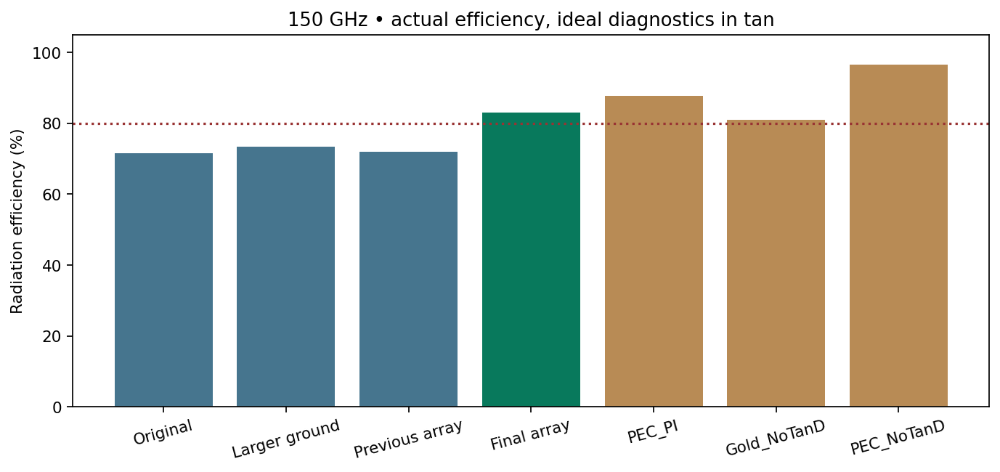

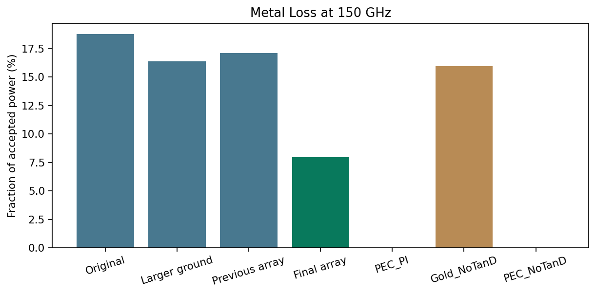

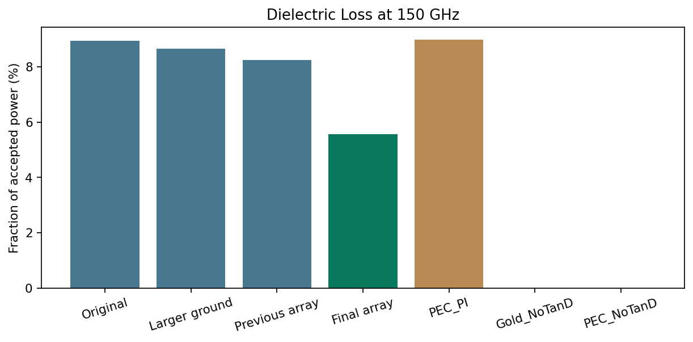

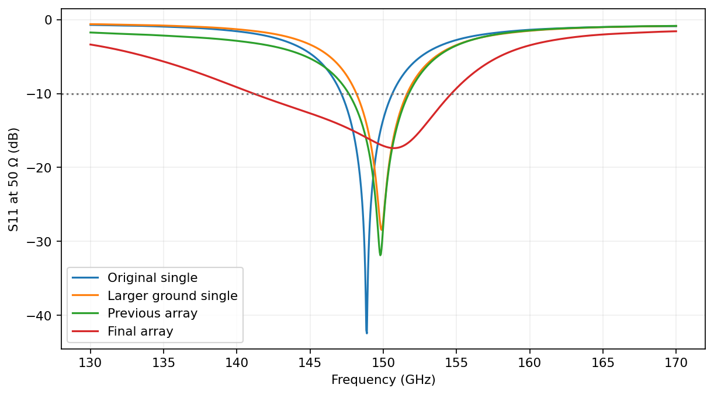

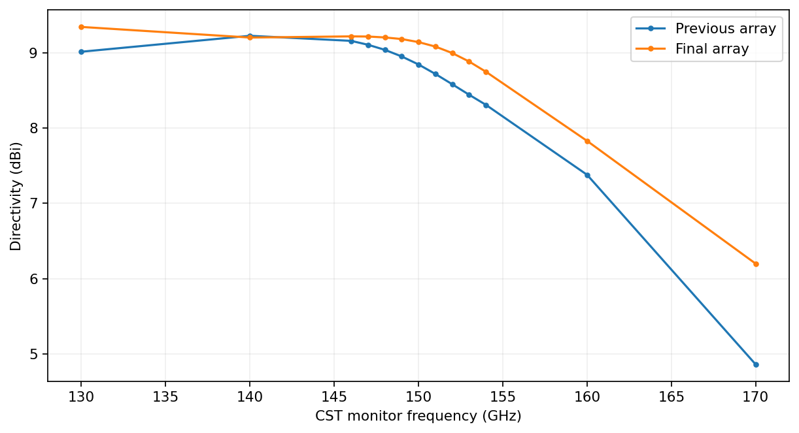

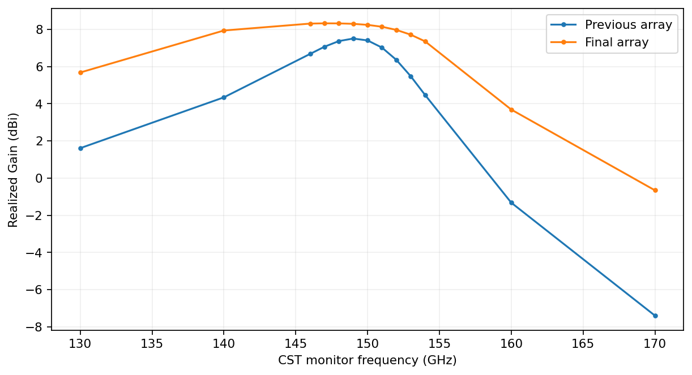

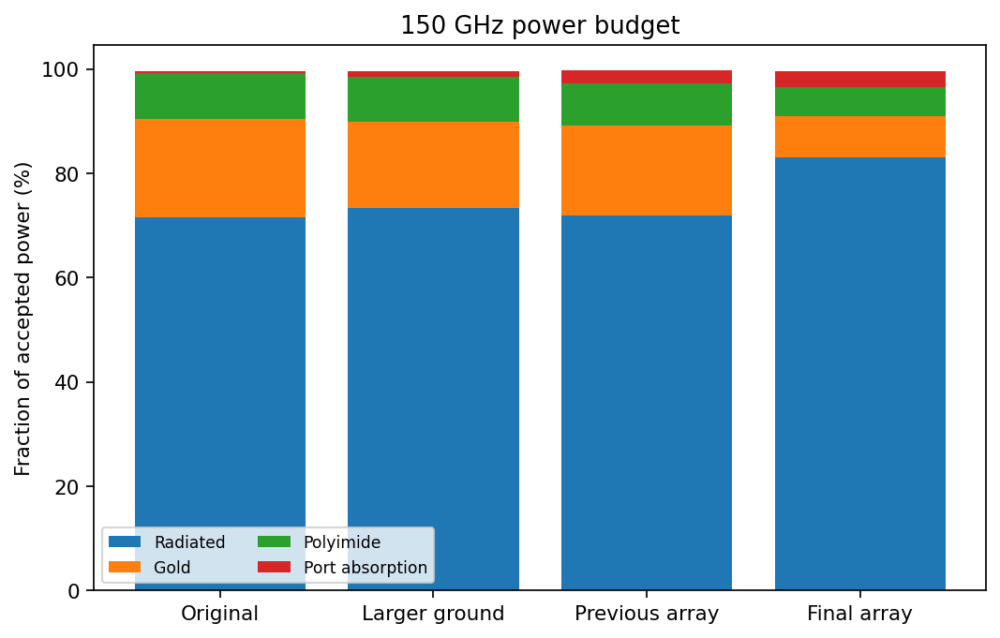

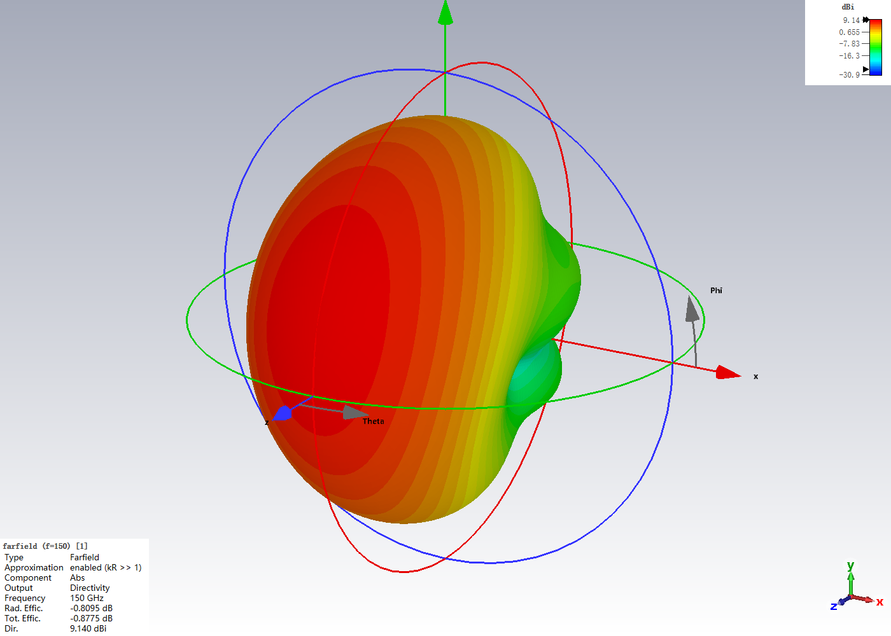

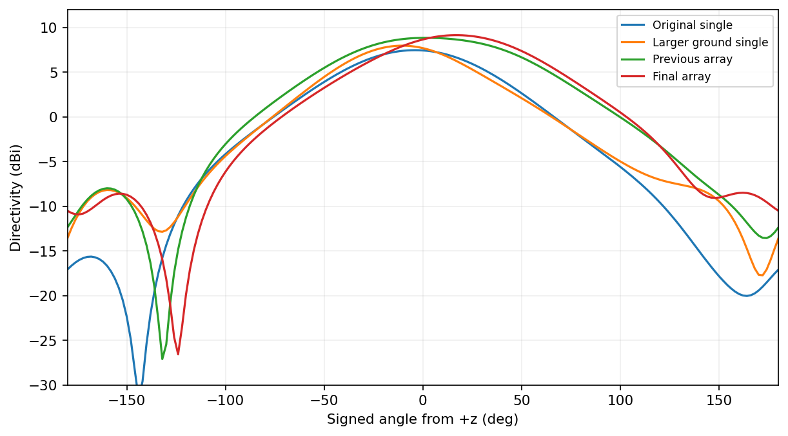

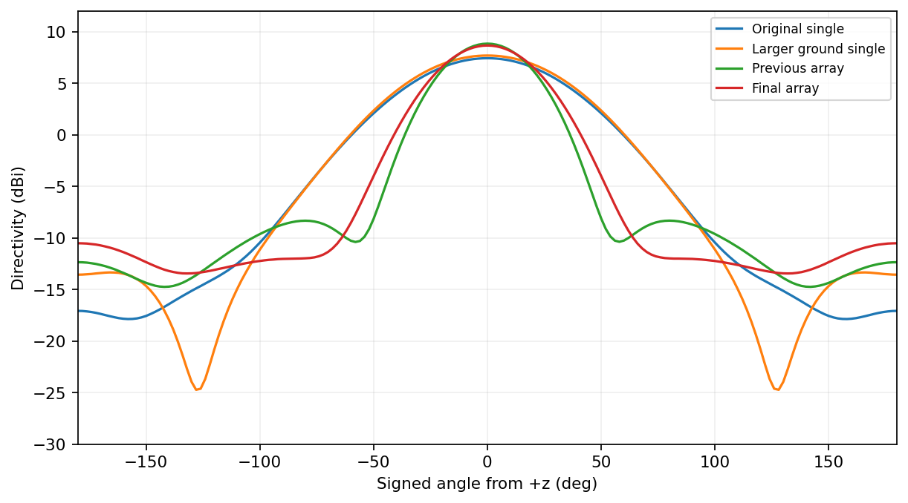

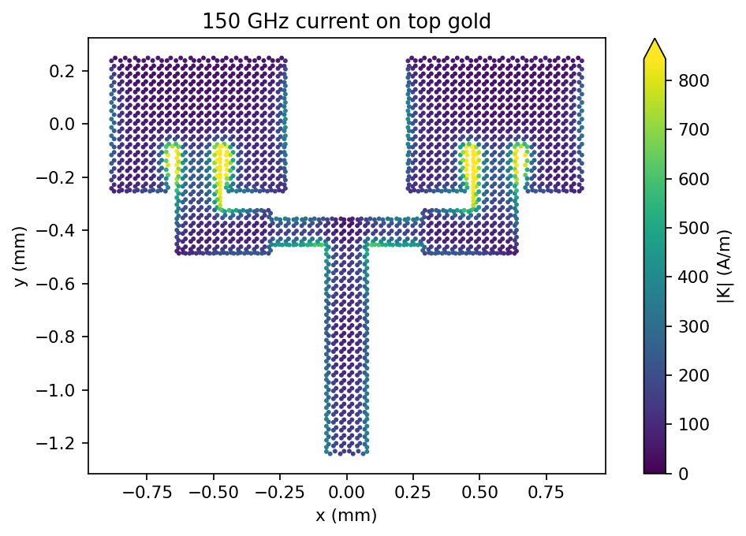

实际制造前应以 150 GHz 介质及金属薄膜实测值更新模型，并检查关键线宽、基板厚度和蚀刻公差。当前结论适用于本材料假设、有限地板和理想端口激励的全波仿真。
